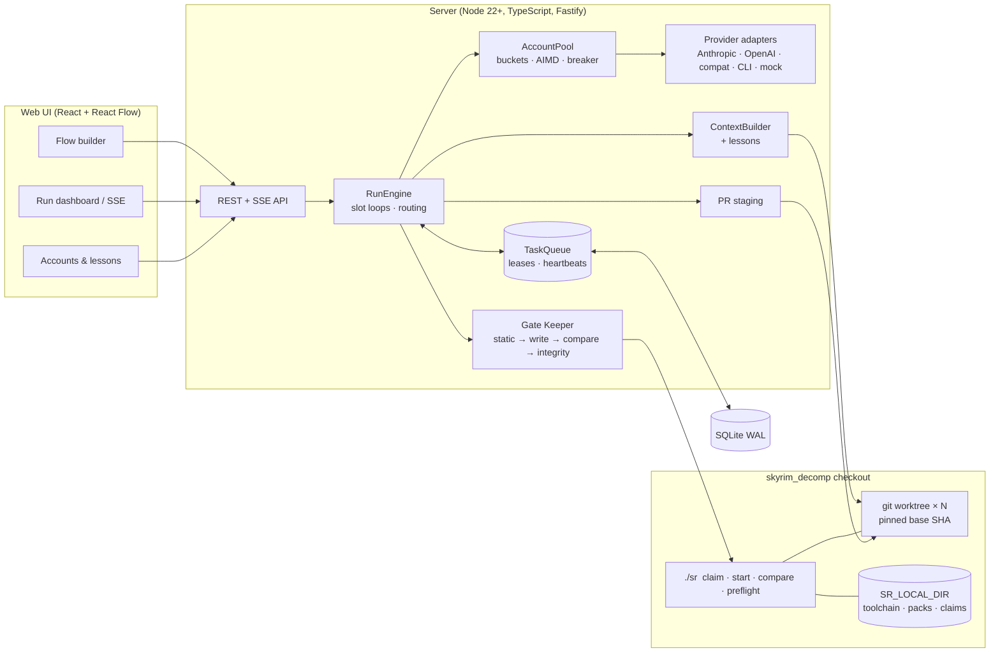

# Architecture

decomp-orchestrator runs many LLM accounts in parallel to draft C++ reconstructions for
[`awarebayes/skyrim_decomp`](https://github.com/awarebayes/skyrim_decomp), and refuses to call
anything "matched" until the repository's own comparator agrees and a set of anti-abuse guards have
passed. This document covers the system design, data model, Gate Keeper/sandbox design, and the
trade-offs behind the defaults.

## 1. System overview

| Component | File(s) | Responsibility |
|---|---|---|
| Flow model | `packages/core/src/flow.ts` | Validate a canvas graph and compile it to a plan: 1 orchestrator, an ordered ladder of worker tiers (`dispatch` → `escalate` chain), gate keepers, retry loops. |
| Engine | `apps/server/src/orchestrator/engine.ts` | Discover → partition → enqueue; one loop per worker slot; lease → prepare → bundle → model → gate → route; pause/resume/cancel; crash recovery. |
| Queue | `apps/server/src/queue/taskQueue.ts` | Durable lease-based queue with conditional transitions and per-unit mutual exclusion. |
| Account pool | `apps/server/src/pool/scheduler.ts` | Multi-account/multi-workspace scheduling under rate limits and partial failures. |
| Providers | `apps/server/src/providers/*` | Uniform `complete()` over the Anthropic SDK, OpenAI SDK (incl. any OpenAI-compatible base URL), Claude Code / Codex CLI profiles, and a fault-injecting mock. |
| Context | `apps/server/src/orchestrator/context.ts`, `lessons.ts`, `prompts.ts` | Deterministic per-packet Task Context Bundles; lessons from repo docs, PR history, and the run itself. |
| Gate Keeper | `apps/server/src/gatekeeper/*` | Scope, leak, and cheat rules; integrity and tamper checks; repo compare/preflight; optional block-only LLM review. |
| Repo adapters | `apps/server/src/repo/srRepo.ts`, `simRepo.ts` | Real `./sr` driver in git worktrees; in-memory simulator with the same interface. |
| Staging | `apps/server/src/orchestrator/staging.ts` | Group accepted units into PR batches (≤ 60 functions), re-verify the combined result, commit to local branches. Never pushes. |
| API / UI | `apps/server/src/api/server.ts`, `apps/web` | REST + SSE; flow builder, dashboard, accounts. |

### Role classes

* **Orchestrator** reads the repository state (docs, conventions, PR review history) and discovers
  the backlog through `./sr next`, which returns mapped, unclaimed functions ranked by readiness.
  It partitions the backlog into bounded *packets*: 1–N functions of the same unit, because a unit's
  `.h`/`.cpp` are shared files. It dispatches packets to the entry worker tier, aggregates verdicts,
  and handles re-queues. In Phase 1 the Orchestrator is deterministic code. The node's account
  binding is reserved for an LLM planner (Phase 2: prioritising and annotating packets).
* **Worker** tiers draft units from a Task Context Bundle. A tier is a flow node with `instances`
  parallel slots, its own account binding, and its attempts (`maxAttempts`, the only retry setting).
  Tiers chain with `escalate` edges, for example cheap Sonnet/GPT/local models first, Opus for the
  stragglers. This mirrors the repo's own `cheap`/`full` profiles and stopping rules.
* **Gate Keeper** nodes select which checks run. Multiple gate nodes merge their settings, and the
  strictest wins. The checks are deterministic, with an optional LLM reviewer that can only add
  blocking findings.

## 2. Data and state model

All schemas are Zod (`packages/core/src/schemas.ts`); the same definitions validate API bodies,
stored JSON columns, and UI types.

| Entity | Key fields | Notes |
|---|---|---|
| `Account` | `id, provider, workspace, baseUrl, auth, models[], limits, tags, priority, enabled, options` | `auth` is `api_key`/`oauth_token` with a **secretRef** (`env:NAME` or `file:PATH`, never the secret), `cli_profile` with an isolated `configDir`, or `none`. `models[]` carry roles, context/output limits, default effort and prices. `limits`: RPM, input/output TPM, max concurrency, daily USD budget. |
| `AccountRuntime` | `status, cooldownUntil, inFlight, consecutiveFailures, 429s, tokens, costUsdToday, ewmaLatencyMs, lastError` | Persisted (`account_runtime`) so cooldowns and quota states survive restarts. |
| `Flow` / `FlowNode` / `FlowEdge` | node: `type (orchestrator\|worker\|gatekeeper), position, data{label, instances, pool{strategy, accountIds, tags, model, effort}, maxAttempts, stuckAfter, gate{…}}`; edge: `kind (dispatch\|submit\|reject_retry\|escalate\|report)` | Saved as named presets. A run stores a **snapshot**, so editing a preset never changes a running run. |
| `Run` | `status, config, flow (snapshot), costUsd` | `RunConfig`: selection (`sr_next`/`rva_list`/`synthetic`), packet size, gate concurrency, PR batch size, compare timeout, budget, **exposureConsent**, draftedBy. |
| `Task` (packet) | `unit, functions[], state, priority, tier, attemptsTotal, attemptsAtTier, noImprovementStreak, bestExactBytes, cheatStrikes, infraFailures, providerFailures, leaseId, leaseExpiresAt, notBefore, lastVerdictId, srTaskId` | States: `pending → leased → gating → passed → staged`, or `dead` / `quarantined` / `cancelled`. Unique on `(run, unit, sorted RVAs)`, so discovery is idempotent. |
| `Attempt` | `n, tier, nodeId, accountId, model, status, bundleHash, usage, costUsd, latencyMs, error, files` | Status: `running`, `completed`, `provider_error`, `parse_error`, or `abandoned` (crash/abort; does not count against budgets). |
| `Verdict` | `decision (pass\|reject\|quarantine), route (accept\|retry\|escalate\|quarantine\|dead_letter), findings[], compare[], exactBytes, stages[]` | `findings[]` carry `stage, code, severity, file, line, message`, the exact trace fed back to the next attempt. |
| `ContextBundle` | `hash, allowedPaths, sections[], containsPrivate` | Persisted for audit with private sections **redacted** (only length + hash). |
| `TelemetryEvent` | `seq, ts, runId, taskId, kind, level, msg, data` | Append-only per-function log, streamed over SSE. |

SQLite runs in WAL mode with `synchronous=NORMAL`. All SQL is portable (TEXT JSON, epoch-ms
integers, conditional UPDATEs), and only `db/database.ts` and `db/store.ts` touch SQL directly.
Moving to Postgres means swapping `json_extract` for `->>` and the lease query for
`… FOR UPDATE SKIP LOCKED`.

## 3. Execution engine (500+ functions per run)

* **Slots.** Every worker tier contributes `instances` slots, and each slot owns one git worktree.
  If the flow wants more slots than the repo has worktrees, tiers are scaled down proportionally,
  with at least one slot per tier.
* **Lease loop.** A slot leases one `pending` task of its tier (`BEGIN IMMEDIATE`). Packets on a
  unit that is already leased or gating are skipped. A heartbeat extends the lease every
  `heartbeatMs`. A failed heartbeat (lease reclaimed, run cancelled) aborts the slot's work through
  an `AbortSignal` that is threaded into the provider call and the repo tooling.
* **Attempt.** Reset worktree → write units accepted earlier in this run (*carried*) → `sr claim
  --offline-ok` + `sr start --no-branch` (serialised across slots, because they write shared
  `SR_LOCAL_DIR` state) → bundle → `pool.acquire()` → model → parse `{"files":[…]}` → gate → route.
* **Routing.**
  * Pass: `passed`.
  * Quarantine: `quarantined`.
  * Infra failure: `pending` with linear backoff; does not consume an attempt; dead-lettered after
    `maxInfraFailures`.
  * Provider failure (429, 5xx, timeout): `pending` immediately, and the scheduler routes the retry
    to a healthy account. No attempt is consumed. Dead-lettered after `maxProviderFailures`.
  * Refusal or bad request: consumes an attempt, because that is about the packet, not the account.
  * Rejection: retry at the same tier with the verdict trace and the previous candidate. The task
    escalates to the next tier after exactly the tier's `maxAttempts` (format-only rejections do not
    count). On the last tier it is dead-lettered. `stuckAfter` and the run's `promoteAfterFailures`
    are no longer used (kept so saved flows and runs load).
* **Crash recovery.** On boot every lease is stale by definition. Leased and gating tasks return to
  `pending`, running attempts become `abandoned`, and runs that were `running` resume. A periodic
  reaper also reclaims leases from slots that stalled without the process dying. The engine tests
  and the simulator kill the engine mid-run and assert completion without double-processing.
* **Controls.**
  * Pause: graceful, so in-flight attempts finish.
  * Pause now: aborts in-flight attempts, which are not counted.
  * Resume and cancel.
  * Per-run USD budget: auto-pauses the run when reached.
  * Per-account daily budget: the account goes `quota_exhausted` until UTC midnight.
* **Telemetry.**
  * Queue depth, in flight, and busy slots.
  * State, route and tier counts.
  * Matched functions per minute and ETA.
  * Tokens and cost, overall and per account/model.
  * Account health: status, cooldown, AIMD limit, headroom, 429s.
  * Live event log, plus per-packet attempts, verdicts and diffs.

## 4. Multi-account scheduler

Each account has:

1. **Token buckets** for requests/min, input tokens/min, and output tokens/min. `acquire()`
   reserves from estimates (prompt length; a fraction of max output). `release()` reconciles with
   actual usage, refunding or going into debt, and clamps to provider-reported `remaining` headers
   when present.
2. **Adaptive concurrency (AIMD).** The limit grows by `+1/limit` per success and halves on every
   429, capped at `maxConcurrency`. Unknown or shifting provider limits are discovered rather than
   guessed. The simulator gives one workspace a *hidden* server-side RPM cap to exercise exactly
   this.
3. **Health state machine.**
   * `ok → cooling` on 429, honouring `retry-after`, otherwise exponential backoff with jitter.
   * `→ circuit_open` after N consecutive 5xx/timeouts; then `half_open` admits one probe; success
     returns to `ok`, failure re-opens the circuit for double the time.
   * `→ quota_exhausted` on billing/credit/quota errors or the daily budget.
   * `→ disabled` on 401/403, until an operator resets it.
   * Request-caused errors (400, refusals, our own aborts) never penalise an account.
4. **Selection.** Score = priority, then token headroom and free concurrency, minus error rate and
   latency, plus jitter. `acquire()` sleeps only when *no* account in the binding can admit the
   request: until the earliest cooldown ends, a bucket refills, or a lease is released. One
   throttled account therefore never stalls a run.

Bindings: `pool` (any enabled account carrying all the node's tags) or `bound` (exactly the listed
accounts), plus an optional model override and effort.

## 5. Gate Keeper and sandboxing

The pipeline runs cheapest-first and short-circuits. **Nothing is written to disk, and nothing
reaches the compiler, until the static stages pass.**

| # | Stage | What it checks | On failure |
|---|---|---|---|
| 1 | `scope` | Every returned path ∈ the packet allowlist (the unit `.h`/`.cpp` from `sr start`). Rejects traversal, absolute paths, backslashes, drive letters, illegal characters, duplicates, protected roots (`tools/`, `.github/`, `builds/`, `data/`, `tests/`, recipes, `sr`) and other units. Enforces caps on files, bytes, lines and line length (byte dumps). | Never written; strike |
| 2 | `leak` | TS port of the repo's `tools/leakgrep.py` over **added lines**: asm mnemonics with operands, decompiler identifiers (`FUN_`, `param_1`, `iVar1`, `undefined8`…), long hex/byte runs, asm directives, host paths, includes outside the allowed roots. | Never written; strike |
| 3 | `cheat` | On comment/string-stripped code: inline asm, `__emit`, naked functions; byte arrays (byte-typed initialisers or ≥8 byte-sized hex literals); `\x` strings; absolute addresses cast to pointers; `#pragma` other than `once`, `##`, `#line`, `#undef`, keyword macros; references to verifier inputs (`compare.py`, target hashes, `.local/`); **stubs** (trivial body where the target is ≥ 24 bytes); **previously matched bodies removed or modified** (base revision, or units accepted earlier in the run); header conventions (≤ 6 lines, no licence text, honest `Code origin:`), `static_assert` without message. | Never written; strike or convention reject |
| 4 | write | Writes go through a realpath check, so a symlink cannot redirect them outside the worktree. | |
| 5 | `integrity_pre` | `git status` (incl. untracked + ignored) ⊆ allowlist ∪ prepare's tooling changes. The repo's own `leakgrep.py` runs on the real diff. | Strike |
| 6 | `compare` | `./sr --json compare <task>` under a global compare semaphore, with a wall-clock timeout (process-tree kill), an output cap, and a scrubbed environment (no `*KEY*`/`*TOKEN*`/`*SECRET*` variables reach repo tooling). Exit codes are mapped: 0 pass, 1 mismatch, 3/4 compile/unit problem (the candidate's fault), 2/5/7/8 or timeout (infra). | Retry with per-function reason, first mismatch, exact bytes and hint |
| 7 | `integrity_post` | Digest of protected paths unchanged after running repo tooling; no stray files. | **Quarantine** (tamper) |
| 8 | `preflight` | `./sr --json preflight <task>` (label/origin/header lint). | Retry with the problems |
| 9 | `review` | Optional LLM review against the repo's reviewer checklist (byte steering, implausible source, hidden fields, provenance, gaming). Source is framed as untrusted data. It **can only block**, never override a deterministic failure. Reviewer outage counts as infra, never as a pass. | Retry, or strike for gaming |

**Strikes.** Gaming-class codes (scope escapes, leaks, cheats, integrity violations) increment
`cheatStrikes`. The default is to retry once with the exact finding and quarantine on the second
strike, because a model that keeps gaming the check burns budget and taints the batch. Quarantined
packets wait for a human, who can requeue them at any tier.

**False positives and negatives.** `test/gate-rules.test.ts` is a labelled corpus. It contains 15
legitimate patterns that must stay clean: prose in comments mentioning forbidden words, float
tables, decimal int tables, hex masks, digit separators, `this`-relative pointer arithmetic, tiny
targets that really are `return false;`, whitespace-only reformatting of matched bodies, pinned
revision hashes, and others. It also contains 33 cheats that must be caught. The suite asserts
**0 FP / 0 FN** and is the place to grow coverage as new cheating patterns appear. Known blind
spots, accepted as trade-offs:

* `static_assert(std::is_same_v<A, B>)` with no message is not flagged (the template comma looks
  like a second argument).
* Byte steering written in plausible C++ is left to the comparator and the optional LLM reviewer.

**Isolation layers (default → hardened).**

1. *Default (local):*
   * Workers never touch the filesystem or run commands; they only return file contents. That
     removes the tool-use attack surface entirely.
   * Each slot uses its own git worktree, pinned to one base SHA and reset (`reset --hard`,
     `clean -ffdx`) before and after every attempt, then verified clean.
   * Repo tooling runs bounded (timeout, output cap, scrubbed env, cwd = worktree).
   * Candidate C++ is only *compiled*, never executed. Includes are restricted by the leak rules
     before compilation, closing the "include a host file into diagnostics" vector.
   * Protected-path digests detect tooling side effects.
2. *Container (opt-in, `sandbox.mode: "docker"`):* the same `contrib.py` command runs in
   `docker run --network none --cap-drop ALL --security-opt no-new-privileges --read-only
   --pids-limit 512 --cpus N --memory M` with only the worktree and `SR_LOCAL_DIR` mounted. This
   adds kernel-level FS and network isolation and CPU/memory ceilings. It needs an image containing
   Python plus the repo's Wine/MSVC toolchain. Recommended for unattended 24/7 runs or untrusted
   model endpoints.
3. *Future:* a dedicated low-privilege OS user per slot, and on Windows a Job Object with memory
   and process limits.

**Scale.** Compares are CPU-bound (MSVC, under Wine on macOS/Linux) and independent of LLM
concurrency, so `gateConcurrency` caps them separately from worker slots. Worktrees are reused
across attempts. Static stages cost milliseconds and reject before any compile. At 500+ packets the
bottleneck is compare throughput, so set `gateConcurrency` to roughly physical cores ÷ 2.

## 6. Target repo intelligence

* **Backlog:** `./sr --json next --count N --max-size S`. It returns mapped, unclaimed functions
  with unit paths and readiness rank, the repo's own heuristic of declaration and draft readiness.
  An explicit RVA list is also supported.
* **Bundle**, in a fixed order with a stable hash:
  * Packet spec (RVAs, sizes, names, name origins, allowed paths).
  * Repo rules, size-capped and explicitly marked when truncated: `contributor-card.md`,
    `contributor-lessons.md`, `matching-cookbook.md`, `declaration-kit.md`.
  * Lessons.
  * The unit files as prepared by `sr start` (skeleton, plus anything carried from earlier packets).
  * One level of included headers.
  * The private pack (`bytes.txt`, `decomp.c`), **only if the run has exposureConsent**.
  * On retries: the previous verdict (comparator results with first mismatch, hints, findings with
    `file:line`) and the previous candidate.
* **Lessons:**
  * Bullets from `docs/contributor-lessons.md`.
  * **PR history:** reason codes from the project bot's PR comments, fetched with your `gh` login.
    Only strictly shaped codes are kept, and comment text is discarded as untrusted.
  * The run's own top rejection codes, mapped to guidance.
  * Phase 2: LLM distillation of human review comments into lessons.

## 7. Trade-offs and assumptions

| Decision | Default | Why / alternative |
|---|---|---|
| Worker capability | Text-in/files-out, no tools | Smallest abuse surface; deterministic; works with every provider. Agentic workers (shell + compare loop inside the model) iterate faster per call but need container isolation and make budgets harder to bound. Possible later as a provider type behind the same Gate Keeper. |
| Isolation | git worktree per slot + bounded processes | Fast, reuses the repo's documented parallel setup (`docs/contributor-parallel.md`). Containers are opt-in hardening, because the MSVC toolchain makes images heavy. |
| Packet scope | Functions of one unit, ≤ 4 per packet; same-unit packets serialised | Units are shared files; serialising avoids merge conflicts. Later packets inherit earlier accepted ones (carried + protected). |
| Persistence | SQLite WAL, single process | Zero-ops, crash-safe, enough for thousands of tasks. Postgres when multiple engine processes or machines share a queue. |
| Claims | `claim --offline-ok` (local only, per repo docs) | Avoids hammering GitHub with hundreds of claims. Run `./sr claim` online before submitting (the PR is the real claim). |
| Submission | Local branches only, re-verified; operator submits | Publishing to a shared project is an outward action. The repo also asks for 20–60 functions per PR, which batching already respects. |
| Game-derived context | Off unless the run sets `exposureConsent` | The project requires the owner's explicit agreement before listings go to an AI provider. Private bundle sections are never persisted. |
| Auth | API keys / OAuth tokens via secret refs; CLI profiles via isolated config dirs | API keys and workspaces give real per-workspace rate limits and billing. CLI profiles (`CLAUDE_CONFIG_DIR`, `CODEX_HOME`) let several logins run side by side. **Check each provider's terms**: pooling is intended for accounts and workspaces you control and pay for, not for evading per-user plan limits. |
| SDK retries | Disabled (`maxRetries: 0`) | Retry and failover belong to the scheduler, so a throttled account immediately yields to another. |
| Refusals | Server-side fallback (`fallbacks: "default"`) on Claude models that support it | Game-engine reversing can trip safety classifiers; the fallback keeps the packet moving. A final refusal consumes an attempt (no account penalty). |
| Structured output | JSON Schema where supported (Anthropic `output_config.format`, OpenAI `json_schema`, compat `json_object`) + Zod validation + tolerant extraction | Robust across providers. Parse failures are attempts with an explicit `OUTPUT_PARSE` trace. |
| Platform | Windows-first (tested), POSIX-compatible | Process-tree kill uses `taskkill /T` on Windows and process groups on POSIX. |

## 8. Delivery status

* **Phase 1 (done):**
  * Multi-account pool and scheduler.
  * Durable queue and engine with crash recovery.
  * Gate Keeper with sandboxing and a labelled FP/FN corpus.
  * Deterministic orchestrator.
  * Simulator.
  * API.
* **Phase 2 (shipped):**
  * React Flow builder.
  * Live dashboard.
  * PR-history lesson ingestion.
  * Complexity classification, capability-tier routing, work stealing and retry promotion.
  * Budgeted TaskContextBundle v2, prompt caching and token telemetry.
  * Run knowledge cache.
  * Details and measured results: **[PHASE2.md](PHASE2.md)**.
* **Phase 3 (shipped):**
  * Skill registry (`packages/skills` + SQLite + SKILL.md mirror) with deterministic triggers.
  * Cache-safe injection: core skills frozen into the static prefix per run, dynamic skills after the shared breakpoint, prefix pre-warm.
  * Skill curator: repo-history bootstrap, retry-win mining, failure-cluster patching, core promotion, compression, deprecation.
  * Shadow evaluation through the real Gate Keeper before any skill or edit is used.
  * Details and measured results: **[PHASE3.md](PHASE3.md)**.
* **Phase 4 (shipped):**
  * FunctionGatherer over the repository's inventory, `sr next`, claims, unit sources, packs and an optional function table, with filters and counted exclusions.
  * Hard per-worker function cap (default 60), charged atomically with the lease; capacity planning, stall pause and in-run cap raise.
  * Worker quota UI, gather preview, live capacity warnings.
  * Details: **[PHASE4.md](PHASE4.md)**.
* **Next:**
  * LLM orchestrator planner (prioritisation across units, dependency ordering from call graphs).
  * Agentic workers in containers.
  * Postgres store for multi-host runs.
  * Run-level reports and cost forecasting.
